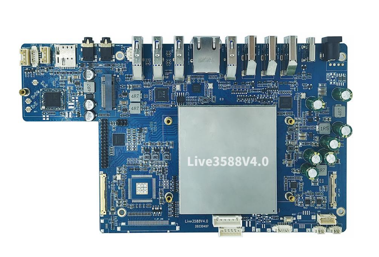
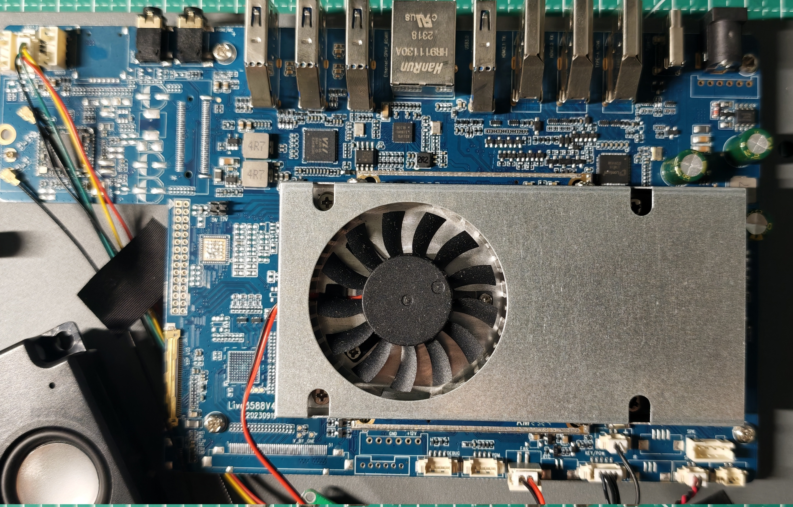
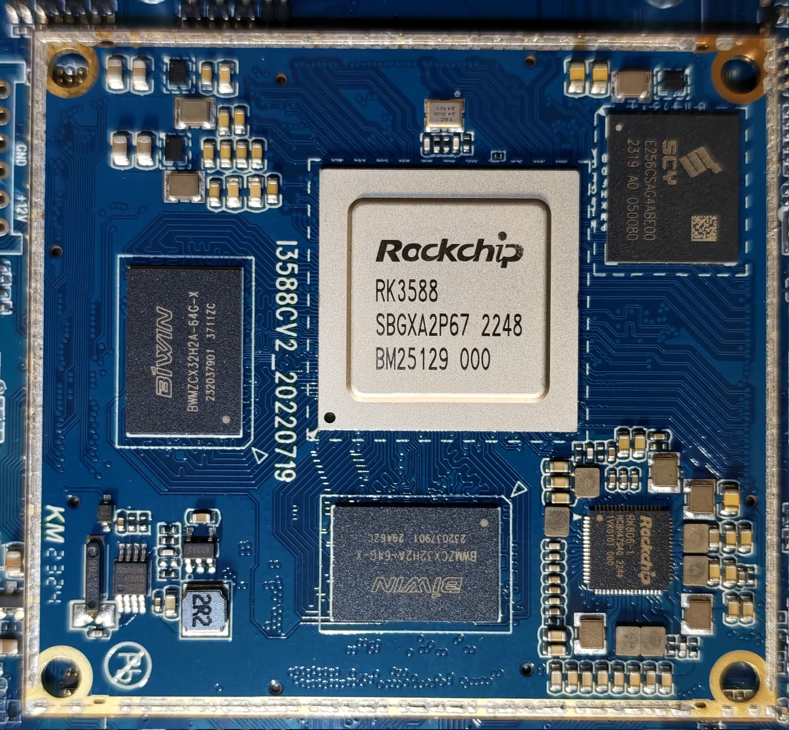
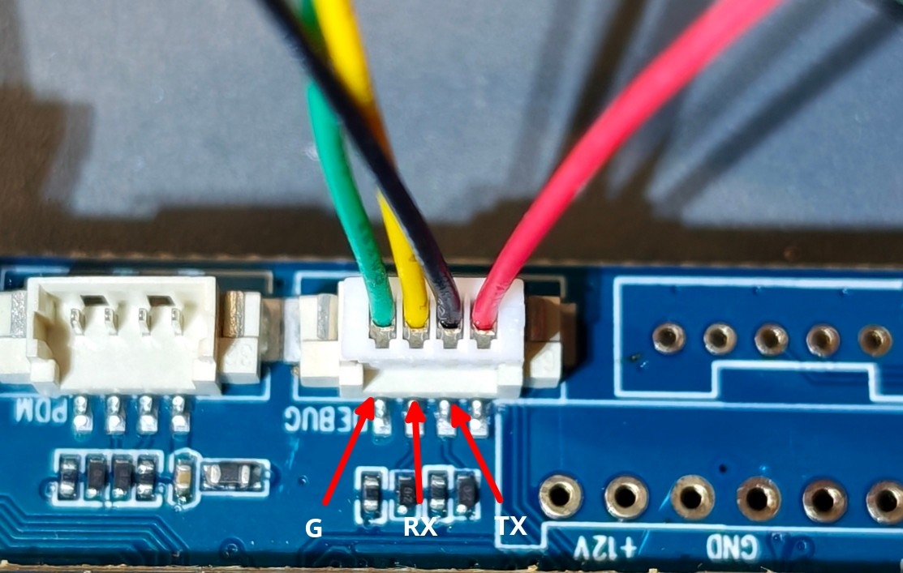
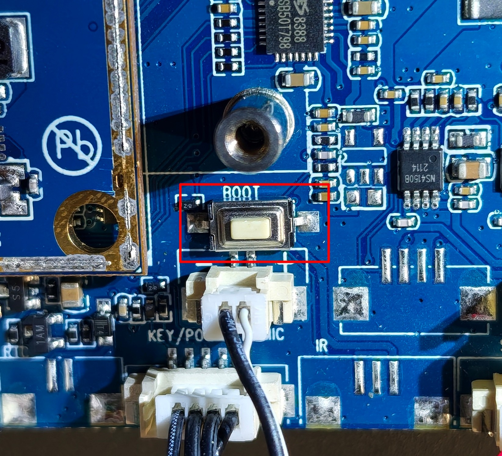

# 9Tripod Live3588V4

English · [简体中文](README.zh-CN.md)

The [Live3588v4.0 live-streaming board](http://www.9tripod.com/showpro.php?id=139) from 9Tripod (Shenzhen 9Tripod Technology Co., Ltd.) is based on the Rockchip RK3588 octa-core processor (4×A76 + 4×A55), with LPDDR4/4X memory (8GB/16GB options) and eMMC storage (128GB/256GB options). It has an official Android port and provides eDP and LVDS display interfaces, targeting live-streaming use cases.

The board uses a separate carrier board and core board architecture; the core board is the [I3588 core board](http://www.9tripod.com/showpro.php?id=125).

The specifications published on the official website only cover revision 4.0. Physical teardown confirms that the hardware revisions actually in circulation have advanced to V4.2 and V4.3, which differ from 4.0 by minor changes in peripheral component selection and PCB layout.

The table below lists common live-streaming devices that use 9Tripod live-streaming boards:

| Device | Board |
| --- | --- |
| Lingxi all-in-one live-streaming device (聆晰直播一体机) | Live3588V4.2 |
| Jiuying G5 (九影G5) | Live3588SV54 |

**The information in the following sections corresponds to the Lingxi all-in-one live-streaming device (Live3588 V4.2) hardware revision.**

## Hardware

| Specification | Description |
| --- | --- |
| Model | LE2110 |
| Carrier board PCB revision | Live3588V4.2 20230919 |
| Core board PCB revision | I3588CV2_20220719 |
| SoC | Rockchip [RK3588](https://www.rock-chips.com/a/en/products/RK35_Series/2022/0926/1660.html) / 8nm / 8 cores (4×Cortex-A76 @2.4GHz + 4×Cortex-A55 @1.8GHz) / Mali-G610 MP4 GPU / 6 TOPS NPU / 8K@60fps H.265/VP9 decode, 4K@60fps AV1 decode, 8K@30fps H.264/H.265 encode |
| DDR | 2 × 8GB BIWIN [BWMZCX32H2A-64G-X](https://www.biwintechnology.com/product/lpddr4-4x/) / LPDDR4/4X / FBGA200 / 4266 Mbps |
| eMMC | 256GB SCY [E256CSAG4ABE00](https://www.shichuangyi.com/qianrushicunchuxinpian/7.html) / eMMC5.1 |
| PMIC | Rockchip [RK806-1](https://item.szlcsc.com/5789556.html) / companion PMIC for RK3588 / SPI / 10×BUCK + 5×NLDO + 6×PLDO / interrupts: PWRON, HOTDIE, VDC, VB_LO |
| WiFi | Realtek RTL8852BE / 802.11ax WiFi 6 / 2T2R / PCIe |
| BT | Realtek RTL8852BE / BT 5.2 / USB 2.0 |
| Gigabit PHY | Realtek [RTL8211FD-CG](https://item.szlcsc.com/2790637.html) / 10Base-T, 100Base-TX and 1000Base-T |
| USB3 controller | VIA Labs (VLI) [VL805-Q6](https://www.via-labs.com/product_show.php?id=48) / PCIe 2.0 x1 -> USB 3.0 xHCI, 4 ports |
| Type-C port controller | onsemi [FUSB302BMPX](https://www.onsemi.cn/products/interfaces/usb-type-c/fusb302b) / max 100 W / marking PBAB CLH |
| Camera | Sony [IMX766](https://bbs.16rd.com/citiao-sensor-imx766.html) / MIPI CSI-2 |
| HDMI-to-MIPI bridge | Lontium [LT6911C](https://m.elecfans.com/article/2107781.html) / HDMI 1.4 -> MIPI CSI |
| Stereo audio codec | Everest [ES8388](https://item.szlcsc.com/339918.html) / 2×ADC + 2×DAC / 24-bit |
| Audio power amplifier | Nsiway [NS4150B](https://www.nsiway.com.cn/list_38/82.html) / 3W / mono / Class D |
| SPI NOR flash | BRIGHTMOON T25S40 / 4Mb |
| USB audio | Cmedia [HS-100C](https://warmseaic.com/cmedia/hs-100c) / USB 2.0 |
| DC-DC | MPS [MP8759GD-Z](https://www.monolithicpower.cn/cn/mp8759.html) / synchronous buck / 26V / 8A / marking AQQ P52 789 |
| MOSFET | MSKSEMI [AO4480-MS](https://item.szlcsc.com/3498500.html) / N-channel / marking 4480 MS80N |

| Interface | Description |
| --- | --- |
| Power input | 12V/5A DC jack |
| USB 3.1 Type-C | TCPC: **FUSB302B** |
| HDMI-IN1 | up to 1080P@60fps, via **LT6911C** |
| HDMI-IN2 | HDMI 2.0 RX / up to 4K@60fps |
| HDMI-OUT | HDMI 2.1 TX |
| Ethernet | Gigabit |
| USB 3.0 Type-A × 4 | Host, via **VL805-Q6** |
| Headphone jack | |
| Line-IN | analog line input |
| SIM slot | not populated; connector not soldered |
| USB 2.0 | 2 × 4-pin wire-to-board connector |
| Fill-light connector | 4-pin wire-to-board connector / 5V |
| MIPI CSI | 30-pin connector / camera |
| EDP | 40-pin display cable connector / panel |

## Images

Teardown and component photos are in [images](./images):

- [outside](./images/outside): device exterior
- [inside](./images/inside): carrier board, core board, heatsink/fan, speaker, antennas, USB audio board and close-ups
- [chip](./images/chip): chip markings (RK3588, RK806-1, LPDDR4X, eMMC, RTL8852BE, LT6911C, FUSB302BMPX, etc.)
- [interface](./images/interface): debug UART, Maskrom button

Carrier board `Live3588V4.2 20230919`:

Core board `I3588CV2_20220719`: RK3588 + 2×BIWIN 16GB LPDDR4X + SCY 256GB eMMC + RK806-1:

## Debug UART

## Maskrom Mode

Hold the BOOT button while powering on to enter Maskrom mode.

The factory firmware enables secure boot, so the dedicated [MiniLoaderAll](./loader/MiniLoaderAll.bin) is required.

## Mainline Linux

RK3588 was merged into mainline Linux in 6.3, and by 7.x most core blocks are supported, including CPU/GPU (Panthor), VOP2/eDP/HDMI/DP display, HDMI RX, audio, eMMC/SD, GMAC, PCIe, USB3/Type-C, PMIC/RTC, NPU (Rocket), VPU decode (rkvdec), VICAP (rkcif) and RGA3. The main missing pieces are the VPU encoder (VENC) and RK3588 ISP (rkisp3.0); the rest of the core peripherals are largely covered.

### Device Tree

[rk3588-9tripod-live3588-v4.dts](https://github.com/yjun123/linux/blob/add_9tripod_live3588_v4_support_v7.3/arch/arm64/boot/dts/rockchip/rk3588-9tripod-live3588-v4.dts)

### Distributions

#### Arch Linux ARM

### Drivers

Mainline support status of key peripherals.

| Component | Chip | Mainline driver | Status |
| --- | --- | --- | --- |
|      |      |          |    |

### Peripheral Status

Actual (tested) status of peripherals on the mainline kernel:

- ✅ Working
- ❌ Broken
- 🟡 Partial
- ⬜ Untested

| Peripheral | Status | Notes |
| --- | --- | --- |
|      |      | |

### Firmware

## Issues

### Unimplemented Features

| Feature | Description |
| ---- | ---- |
|      |      |

## References

[9Tripod official website - Live3588v4.0](http://www.9tripod.com/showpro.php?id=139)

[9Tripod official website - I3588 core board](http://www.9tripod.com/showpro.php?id=125)

[9Tripod forum - latest live-streaming device firmware release](http://bbs.9tripod.com/forum.php?mod=viewthread&tid=119419&extra=page%3D1)

[yifengyou/live3588 - 9Tripod Live3588v4.0 development board](https://github.com/yifengyou/live3588)

[Armbian Forum - Request for Firmware – Device Live Broadcast V4 (Board: LIVE3588V4.2) - Eng.ahmedflash](https://forum.armbian.com/topic/54363-request-for-firmware-%E2%80%93-device-live-broadcast-v4-board-live3588v42/)
