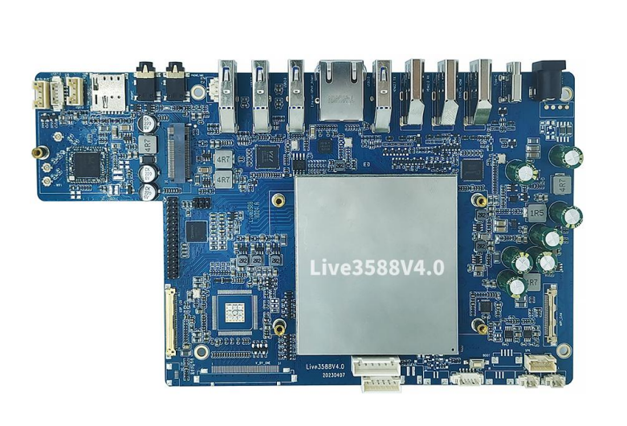
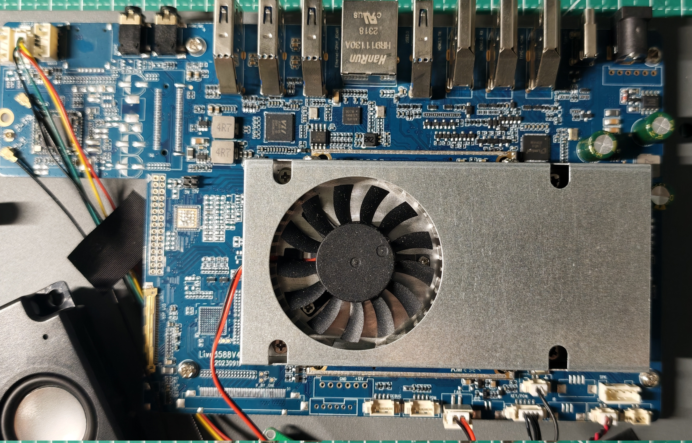
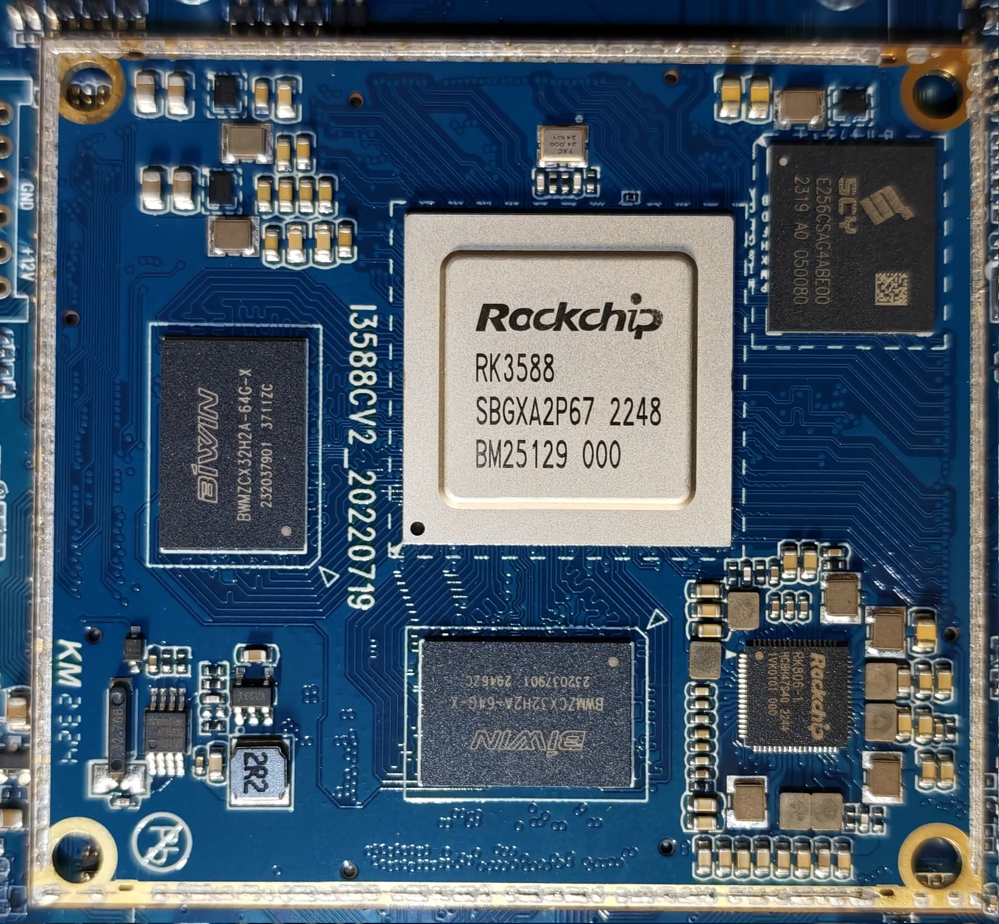
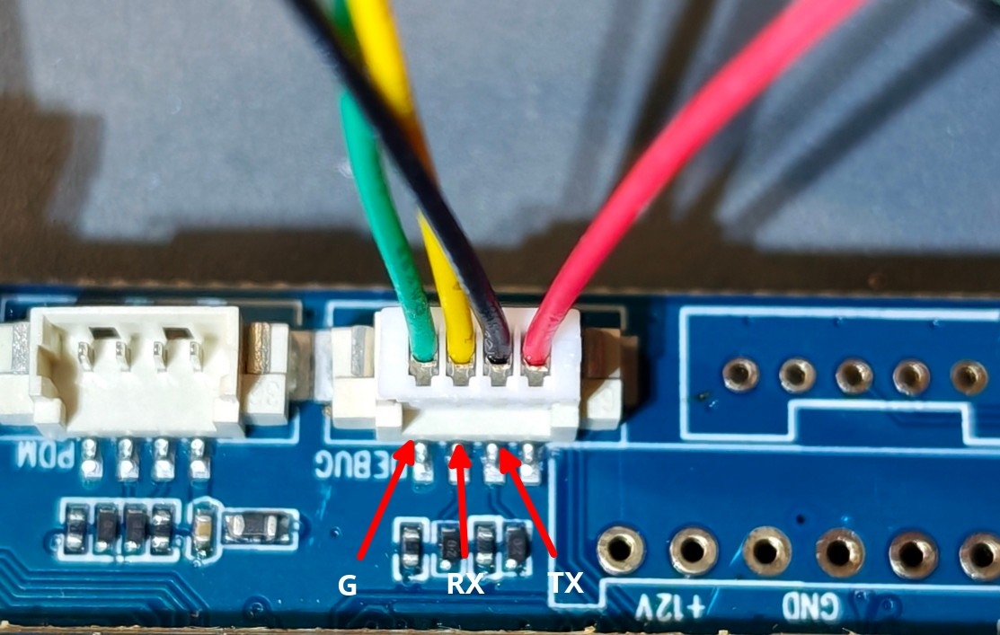
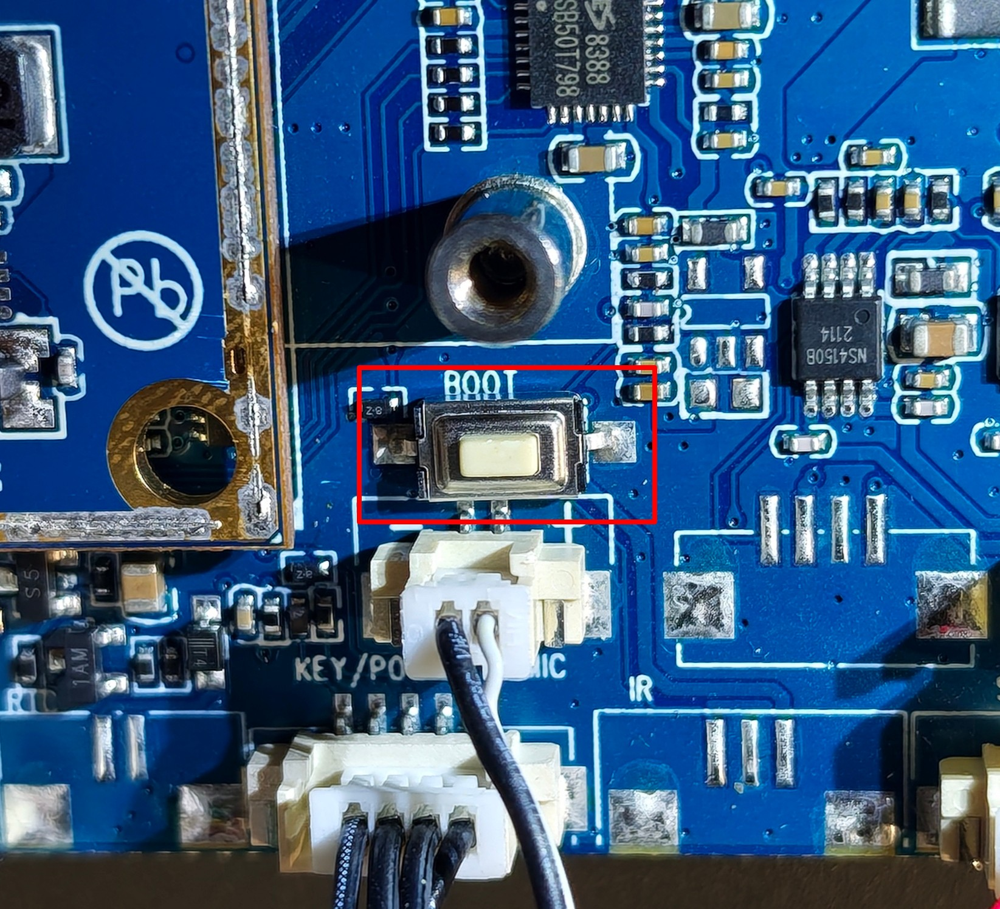

# 9Tripod Live3588V4

[English](README.md) · 简体中文

九鼎创展 [Live3588v4.0 直播机主板](http://www.9tripod.com/showpro.php?id=139)，由深圳市九鼎创展科技有限公司推出，基于
Rockchip RK3588 八核处理器（4×A76 + 4×A55），搭载 LPDDR4/4X 内存（可选 8GB/16GB）与 eMMC 闪存（可选 128GB/256GB），官
方适配了 Android 系统，具备 EDP 屏及 LVDS 大屏接口, 定位为直播机场景的主板方案。

该主板采用底板与核心板分离式架构，核心板为 [I3588核心板](http://www.9tripod.com/showpro.php?id=125)。

官网公布的硬件规格信息仅对应 4.0 版本。经实物拆解验证，市面上实际流通的硬件版本已迭代至 V4.2 与 V4.3，二者相较 4.0 在
外围器件选型及 PCB 布局上均做了小幅调整。

市面上的直播机普遍采用该主板，例如：

| 直播机 | 主板 |
| --- | --- |
| 聆晰直播一体机 | Live3588V4.2 |

## 硬件

以下表格中所列信息对应 Live3588 V4.2 硬件版本。

| 规格 | 描述 |
| --- | --- |
| 型号 | LE2110 |
| 底板PCB 版本 | Live3588V4.2 20230919 |
| 核心板PCB 版本 | I3588CV2_20220719 |
| SoC | 瑞芯微 Rockchip [RK3588](https://www.rock-chips.com/a/en/products/RK35_Series/2022/0926/1660.html) / 8nm / 8 核（4×Cortex-A76 @2.4GHz + 4×Cortex-A55 @1.8GHz） / Mali-G610 MP4 GPU / 6 TOPS NPU / 8K@60fps H.265/VP9 解码、4K@60fps AV1 解码、8K@30fps H.264/H.265 编码 |
| DDR | 2 * 8GB 佰维 BIWIN [BWMZCX32H2A-64G-X](https://www.biwintechnology.com/product/lpddr4-4x/) / LPDDR4/4X / FBGA200 / 4266 Mbps |
| eMMC | 256GB 时创意 SCY [E256CSAG4ABE00](https://www.shichuangyi.com/qianrushicunchuxinpian/7.html) / eMMC5.1 |
| 电源管理芯片 | 瑞芯微 Rockchip [RK806-1](https://item.szlcsc.com/5789556.html) / RK3588 配套 PMIC / SPI / 10×BUCK + 5×NLDO + 6×PLDO / 中断：PWRON、HOTDIE、VDC、VB_LO |
| WiFi | 瑞昱 Realtek RTL8852BE / 802.11ax WiFi6 / 2T2R / PCIe |
| BT | 瑞昱 Realtek RTL8852BE / BT5.2 / USB2.0 |
| 千兆 PHY | 瑞昱 Realtek [RTL8211FD-CG](https://item.szlcsc.com/2790637.html) / 10Base-T、100Base-TX和1000Base-T |
| USB3 控制器 | 威锋 VIA Labs（VLI）[VL805-Q6](https://www.via-labs.com/product_show.php?id=48) / PCIe2.0 x1 -> USB3.0 xHCI 4 口 |
| Type-C 端口控制器 | 安森美 ON Semi [FUSB302BMPX](https://www.onsemi.cn/products/interfaces/usb-type-c/fusb302b) /  Max 100 W  / 丝印 PBAB CLH |
| 摄像头 | 索尼 Sony [IMX766](https://bbs.16rd.com/citiao-sensor-imx766.html) / MIPI CSI-2 |
| HDMI 转 MIPI 桥芯片 | 龙迅 Lontium [LT6911C](https://m.elecfans.com/article/2107781.html) / HDMI1.4 → MIPI CSI |
| 立体声Audio Codec | 顺芯 Everest [ES8388](https://item.szlcsc.com/339918.html) / 2×ADC + 2×DAC / 24bit |
| 音频功率放大器 | 纳芯威 Nsiway [NS4150B](https://www.nsiway.com.cn/list_38/82.html) / 3W / 单声道 / D类 |
| SPI NOR Flash | 亮月 BRIGHTMOON T25S40 / 4Mb |
| USB 音频 | 骅讯 Cmedia [HS-100C](https://warmseaic.com/cmedia/hs-100c) / USB 2.0 |
| DC-DC | 芯源 MPS [MP8759GD-Z](https://www.monolithicpower.cn/cn/mp8759.html) / 同步降压  / 26V / 8A / 丝印 AQQ P52 789 |
| MOSFET | 美森科 MSKSEMI [AO4480-MS](https://item.szlcsc.com/3498500.html) / N 沟道/ 丝印 4480 MS80N |

| 接口 | 描述 |
| --- | --- |
| 供电口 | 12V/5A DC 供电输入座 |
| USB 3.1 TypeC | TCPC 芯片为 **FUSB302B** |
| HDMI-IN1 | 最大支持 1080P@60fps， 通过 **LT6911C** 扩展实现 |
| HDMI-IN2 | HDMI 2.0 RX / 最大支持 4K@60fps |
| HDMI-OUT | HDMI 2.1 TX |
| 以太网口 | 千兆 |
| USB 3.0 Type-A * 4 | Host， 通过 **VL805-Q6** 扩展实现 |
| 耳机口 |      |
| Line-IN | 音频线性输入接口 |
| SIM 卡槽 | 未上料，接口未焊接 |
| USB 2.0 | 2 * 4P 线对板连接器 |
| 补光灯接口 | 4P 线对板连接器 / 5V |
| MIPI CSI | 30P 连接器 / 连接相机 |
| EDP | 40P 屏线连接器 / 连接屏幕 |

## 图片

拆解与器件照片见 [images](./images)：

- [outside](./images/outside)：整机外观
- [inside](./images/inside)：底板、核心板、散热器/风扇、扬声器、天线、USB 音频小板及局部特写
- [chip](./images/chip)：芯片丝印（RK3588、RK806-1、LPDDR4X、eMMC、RTL8852BE、LT6911C、FUSB302BMPX 等）
- [interface](./images/interface)：调试串口、Maskrom 按键

底板 `Live3588V4.2 20230919`；

核心板 `I3588CV2_20220719`：RK3588 + 2×BIWIN 16GB LPDDR4X + SCY 256GB eMMC + RK806-1；

## 调试串口

## Maskrom 模式

按住 BOOT 按键 开机， 进入 Maskrom 模式

直播机原厂固件启用了安全启动，因此必须使用专用的 [MiniLoaderAll](./loader/MiniLoaderAll.bin)。

## Mainline Linux

RK3588 自 Linux 6.3 进入主线，到 7.x 已支持 CPU/GPU（Panthor）、VOP2/eDP/HDMI/DP 显示、HDMI RX、音频、eMMC/SD、GMAC、PCIe、USB3/Type-C、PMIC/RTC、NPU（Rocket）、VPU 解码（rkvdec）、VICAP（rkcif）和 RGA3 等大部分核心模块。主线目前主要缺 VPU 编码（VENC）和 RK3588 ISP（rkisp3.0）驱动，其余核心外设基本齐全。

### 设备树

[rk3588-9tripod-live3588-v4.dts](https://github.com/yjun123/linux/blob/add_9tripod_live3588_v4_support_v7.3/arch/arm64/boot/dts/rockchip/rk3588-9tripod-live3588-v4.dts)

### 发行版

#### Arch Linux ARM

### 驱动

关键外设的主线支持状态。

| 组件 | 芯片 | 主线驱动 | 状态 |
| --- | --- | --- | --- |
|      |      |          |    |

### 外设状态

各外设在主线内核上的实际（测试）状态：

- ✅ 正常
- ❌ 异常
- 🟡 部分可用
- ⬜ 未测试

| 外设 | 状态 | 备注 |
| --- | --- | --- |
|      |      | |

### 固件

## 问题

### 暂未实现的功能

| 功能 | 描述 |
| ---- | ---- |
|      |      |

## 参考

[九鼎创展官网 - Live3588v4.0](http://www.9tripod.com/showpro.php?id=139)

[九鼎创展官网 - i3588核心板](http://www.9tripod.com/showpro.php?id=125)

[九鼎创展论坛社区 - 直播一体机镜像发布最新帖](http://bbs.9tripod.com/forum.php?mod=viewthread&tid=119419&extra=page%3D1)

[yifengyou/live3588 - 九鼎创展 Live3588v4.0 开发板](https://github.com/yifengyou/live3588)

[Armbian Forum - Request for Firmware – Device Live Broadcast V4 (Board: LIVE3588V4.2) - Eng.ahmedflash](https://forum.armbian.com/topic/54363-request-for-firmware-%E2%80%93-device-live-broadcast-v4-board-live3588v42/)
