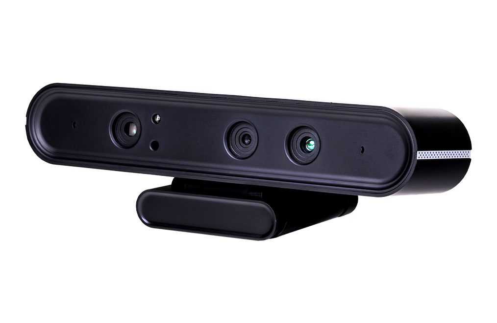

# Orbbec Astra Pro S M

English · [简体中文](README.zh-CN.md)

Speckle structured-light 3D cameras in the Astra series from [Orbbec](https://www.orbbec.com/), with the following models:

| Model | Depth range | RGB | Notes |
| --- | --- | --- | --- |
| Astra | 0.6 ~ 8m | None | First generation, no RGB |
| Astra S | 0.4 ~ 2m | 640×480@30fps | Short-range version, better close-range accuracy |
| Astra Pro | 0.6 ~ 8m | 1280×960@7fps (?) / 640×480@30fps | Built-in microphone, enclosed housing |
| **Astra Pro SM** | 0.35 ~ 1m | 1280x720@9fps / 640×480@30fps | ? |
| Astra Pro Plus | 0.6 ~ 8m | 1920×1080@30fps | 1080p RGB, enclosed housing |

*Astra Pro S M* is a customized camera for face-payment scenarios, released by [Shenzhen 3DMario Technology Co., Ltd.](https://www.3dmario.com/) (originally a joint venture between Orbbec and Ant Group, now a wholly owned subsidiary of Orbbec) (?)

(S for Short, M for Malio ?)

## Hardware

| Spec | Description |
| --- | --- |
| Model | Orbbec Astra Pro S M |
| ASIC | MX400 |
| RGB | OV9712 / 1280*720 |
| IR | MT9M001 / 1280*1024 |
| Speckle projector | * 1 |
| MIC | * 2 |
| Proximity sensor | * 1 |

| Interface | Description |
| --- | --- |
| USB | USB 2.0 Type A |

## Images

Teardown details are in [images](./images).

## RGB UVC Camera

The RGB camera is a separate USB device inside the unit. It follows the UVC 1.00 protocol and is supported directly by the in-kernel `uvcvideo` driver.

| Item | Value |
| --- | --- |
| VID:PID | `2bc5:0501` (Orbbec / Astra Pro HD Camera) |
| bcdUSB / bcdDevice | 2.00 / 27.02 |
| Transfer speed | High Speed 480 Mbps, bus powered, MaxPower 500 mA |
| UVC version | 1.00, `dwClockFrequency` 15 MHz |
| Interfaces | Interface 0 = VideoControl, Interface 1 = VideoStreaming |

| Pixel format | Resolution | Frame rate |
| --- | --- | --- |
| YUYV (4:2:2) | 1280x800 / 1280x720 | 9 fps |
| YUYV (4:2:2) | 640x480 / 352x288 / 320x240 / 176x144 / 160x120 | 30 fps |
| MJPG | 1280x800 / 1280x720 / 640x480 / 352x288 / 320x240 / 176x144 / 160x120 | 30 fps |

## Debug UART

## SDK

[OpenNI2 SDK](https://github.com/orbbec/OpenNI_SDK)

### Firmware

## Issues

## References

[Orbbec - Astra Series](https://www.orbbec.com/products/structured-light-camera/astra-series/)

[CSDN - Astra Pro depth camera quick start (Chinese)](https://blog.csdn.net/2301_80488618/article/details/143720228)

[Doc88 - Astra Pro SM depth camera (Chinese)](https://www.doc88.com/p-80687870136190.html)
