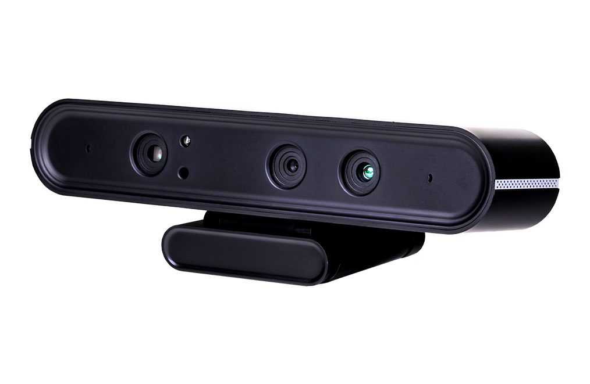

# Orbbec Astra Pro S M

[English](README.md) · 简体中文

[奥比中光](https://orbbec.com.cn/)推出的 Astra 系列散斑结构光 3D 相机, 有以下的型号：

| 型号             | 深度范围  | RGB                                 | 特性                     |
| ---------------- | --------- | ----------------------------------- | ------------------------ |
| Astra            | 0.6 ~ 8m  | 无彩色                              | 初代，无RGB              |
| Astra S          | 0.4 ~ 2m  | 640×480@30fps                       | 近距短程版，近距精度更好 |
| Astra Pro        | 0.6 ~ 8m  | 1280×960@7fps （?） / 640×480@30fps | 内置麦克风，整机外壳     |
| **Astra Pro SM** | 0.35 ~ 1m | 1280x720@9fps / 640×480@30fps       | ？                       |
| Astr Pro Plus    | 0.6 ~ 8m  | 1920×1080@30fps                     | 1080P RGB，整机外壳      |

其中 *Astra Pro S M* 为 [深圳蚂里奥技术有限公司](https://www.3dmario.com/)（最初是奥比中光 + 蚂蚁集团合资，现在是奥比中光全资子公司）推出的用于刷脸支付场景的定制相机（?）

（S 为 Short, M 为 Malio ? ）

## 硬件

| 规格 | 描述 |
| --- | --- |
| 型号 | Orbbec Astra Pro S M |
| ASIC | MX400 |
| RGB | OV9712 / 1280*720 |
| IR | MT9M001 / 1280*1024 |
| 散板投射器 | * 1 |
| MIC | * 2 |
| 接近光传感器 | * 1 |

| 接口 | 描述 |
| --- | --- |
| USB | USB 2.0 Type A |

## 图片

设备拆解细节见 [images](./images)。

## RGB UVC Camera

RGB 摄像头是设备内独立的 USB 设备，遵循 UVC 1.00 协议，由内核 `uvcvideo` 驱动直接支持。

| 项目 | 值 |
| --- | --- |
| VID:PID | `2bc5:0501`（Orbbec / Astra Pro HD Camera） |
| bcdUSB / bcdDevice | 2.00 / 27.02 |
| 传输速率 | High Speed 480 Mbps，总线供电，MaxPower 500 mA |
| UVC 版本 | 1.00，`dwClockFrequency` 15 MHz |
| 接口 | Interface 0 = VideoControl，Interface 1 = VideoStreaming |

| 像素格式 | 分辨率 | 帧率 |
| --- | --- | --- |
| YUYV (4:2:2) | 1280x800 / 1280x720 | 9 fps |
| YUYV (4:2:2) | 640x480 / 352x288 / 320x240 / 176x144 / 160x120 | 30 fps |
| MJPG | 1280x800 / 1280x720 / 640x480 / 352x288 / 320x240 / 176x144 / 160x120 | 30 fps |

## 调试串口

## SDK

[OpenNI2 SDK](https://github.com/orbbec/OpenNI_SDK)

### 固件

## 问题

## 参考

[奥比中光官网 - Astra Series - en](https://www.orbbec.com/products/structured-light-camera/astra-series/)

[CSDN - Astra Pro深度相机初使用--通过openni2调用深度相机（基于python），获取深度信息（学习笔记）- yc天天开心](https://blog.csdn.net/2301_80488618/article/details/143720228)

[道客巴巴 -  Astra Pro SM 深度相机](https://www.doc88.com/p-80687870136190.html)
