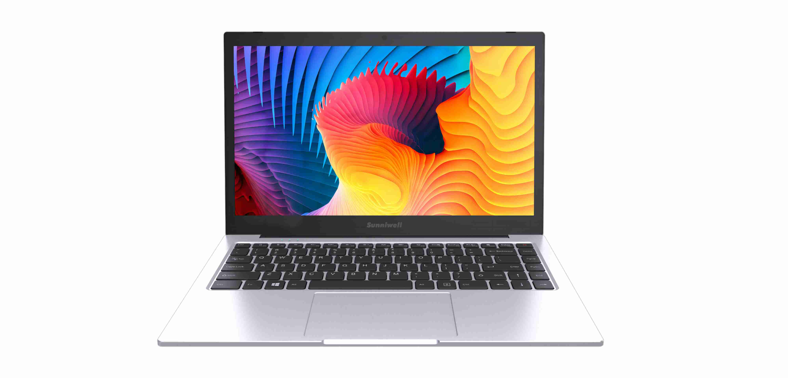
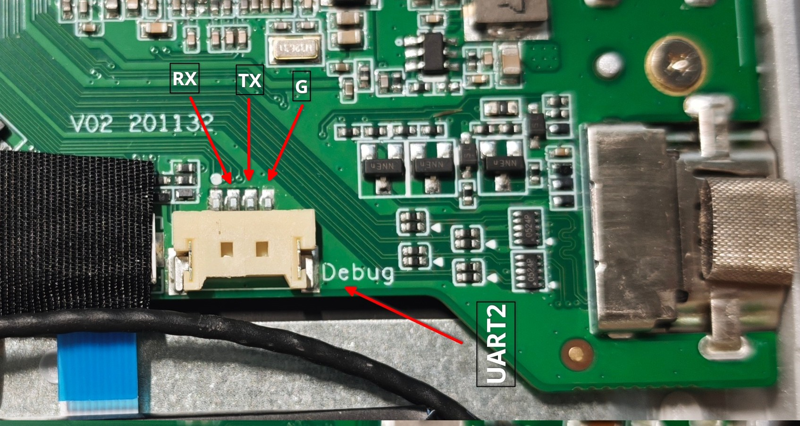
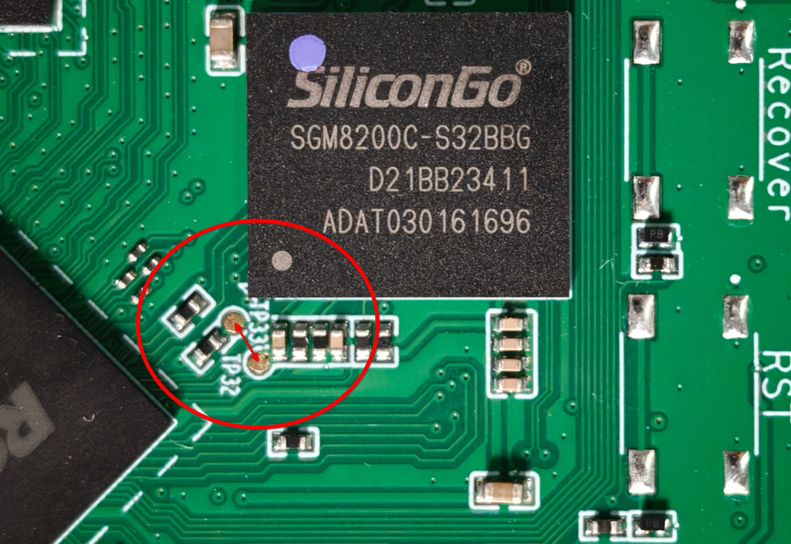
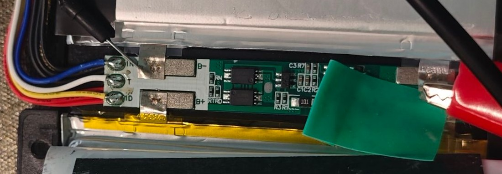

# Sunniwell Z96A

[English](README.md) · 简体中文

[Sunniwell](https://www.sunniwell.com/) Z96A 是一款基于 RK3568 的 ARM 云笔电，预装 Android 11，用于云桌面 VDI 场景。

Z96A 有两个硬件版本，主要区别在于供电输入方式（此外还有一些小的差异）：

- **早期版本（2022？）** — 通过 DC 圆口充电。
- **后期版本（2023）** — 通过 Type‑C 充电；固件在部分地方将此主板识别为 *Z97A*，但外壳标签仍为 *Z96A*。

此外还有 *Z96H* 变体（同样为 Type‑C 充电），但未在二手市场上广泛流通。

## 硬件

列出的硬件目前只包含 Type-C 充电版本。

| 规格 | 描述 |
| --- | --- |
| 型号 | Z96A |
| 主板 PCB 版本 | V02 201132 |
| USB 小板 PCB 版本 | V01 528032 |
| SoC | Rockchip [RK3568B2](https://www.rock-chips.com/a/en/products/RK35_Series/2021/0113/1276.html) @2.0GHz / 四核 ARM Cortex-A55 / Mali-G52 2EE GPU |
| PMIC | Rockchip [RK809-5](https://rockchip.fr/RK809%20datasheet%20V2.7.pdf) / PMIC / 音频编解码器 |
| DRAM | 4GB Rayson [RS1G32LO4D2BDS-53BT](https://szrayson.com/product_23/136.html) / LPDDR4X / x32 / 3733Mbps / FBGA 200-ball / 1.8/1.1/0.6V |
| eMMC | 32GB SiliconGo SGM8200C-S32BBG / HS400 / eMMC 5.1 / FBGA153 |
| WiFi/BT | Realtek [RTL8822CS](https://bbs.16rd.com/thread-602771-1-1.html) / 802.11 a/b/g/n/ac / BT4.2 / 2T2R |
| 显示屏 | BOE [NV140FHD‑N43](https://www.panelook.cn/NV140FHM-N43_BOE_14.0_LCM_overview_cn_27125.html) / 14 英寸 16:9 IPS / 1920x1080 / 31 cm x 17 cm / 60HZ / eDP |
| 键盘 | SinoWealth [SH61F83Q](https://www.sinowealth.com/detaile?pro_id=100) / AMR-TOUCH-MOUSE 202110 USB KEYBOARD / USB 1.1 / 6080:8060 |
| 触控板 | Hynitron [CST128-A](http://www.hynitron.com/product/pen/208) / 连接至 SH61F83Q |
| USB Hub | Genesys Logic [GL852G](https://www.genesyslogic.com.tw/en/product/show.php?num=GL852G&kind=USB2_Hub) / USB 2.0 / 4 MTT / QFN 28 / 05e3:0610 |
| 摄像头 | Microdia Sonix 摄像头 / USB 2.0 / UVC 1.00 / 0c45:6368 |
| Type-C 控制器 | Hynetek [HUSB311BLA](https://www.hynetek.com/2422.html) / CC 检测 / QFN-14L |
| USB 3.1 切换开关 | 未知 / D3EB 2342 F1 |
| 电池充电芯片 | SouthChip [SC8886SQDER](https://www.southchip.com/product/SC8886S) / 8A / QFN-32 |
| 电池 | SHT [3585130-2S](https://www.newlaptopaccessory.com/cn/sht-3585130-2s-3585130-7.4v-37wh-batteries-p-11746.html) / 5000mAh / 37Wh / 8.4V（2S） |
| 霍尔开关 | Yasemi Magnesensor [MH248](https://www.yasemi.com.cn/productinfo/2155346.html?templateId=1133605) |
| 音频 ADC | 3 * Everest [ES7202](http://www.everest-semi.com/pdf/ES7202%20PB.pdf) / Analog -> PDM / 2 通道 |
| 音频功放 | Awinic [AW8737AFCR](https://www.awinic.com/en/evbInfo/AW8737AFCR/289) / Class-K 音频功率放大器 / FCQFN-16L |
| 扬声器 | 2 * [BER-NM14G-R](https://rozetka.com.ua/ua/438553034/p438553034/) |
| DC-DC | Torch [TCS4525](https://www.tctek.cn/product/tcs4525/) / 6A / WCSP-20 |
| N MOSFET | Vgsemi [VS3652DB](https://vgsemi.com/index/good_detail/?id=30&series_id=1) / 非对称双 N 沟道 / 30V / 24A |
| P MOSFET | Ncepower [NCE30P20Q](https://item.szlcsc.com/datasheet/NCE30P20Q/515299.html) / 单 P 沟道 / 30V / 20A |
| 尺寸 | 329.6mm × 220mm × 14.9mm |

| 接口 | 描述 |
| --- | --- |
| 电源 | Type-C *1 |
| USB | USB 2.0 Type A Host * 2 / USB 3.0 Type A Host * 1 / USB 3.1 Type C OTG * 1 |
| HDMI | HDMI 2.0 * 1 |
| 音频 | 3.5mm 耳机孔 *1 |
| 麦克风 | 模拟麦克风 * 2 |
| 扬声器 | 扬声器 * 2 |
| LED | 电源 LED / 大写锁定 LED / 麦克风静音 LED / 充电中 LED / 已充满 LED |

## 图片

设备拆解细节见 [images](./images)。

## 调试串口

Z96A-TYPEC：

- **UART** — UART2
- **波特率** — 1500000, 8N1
- **接口** — MX1.25mm 4P 连接器

## Maskrom 模式

Z96A-TYPEC：

短接箭头标记的测试点，上电进入 Maskrom 模式。

## Mainline Linux

RK3568 是上游 Linux 支持最好的 Rockchip SoC 之一。

初始 SoC 支持（Cortex-A55、GIC、定时器、UART、SD/eMMC、USB3 DWC3、PCIe、GMAC、I2C/SPI/PWM 以及 RK809 PMIC）在 Linux 5.16 合入，

随后 [VOP2](https://github.com/torvalds/linux/commit/604be85547ce4d61b89292d2f9a78c721b778c16) 显示控制器（HDMI / MIPI-DSI）在 5.19 合入。Mali-G52 GPU 由主线 [Panfrost](https://docs.mesa3d.org/drivers/panfrost.html) 驱动。

### 设备树

#### BSP 内核

感谢 [bingo1991](https://github.com/bingo1991) 和 [kemp233](https://github.com/kemp233) 完成了两个版本在 Rockchip **BSP** 内核上的设备树适配：

- **早期版本（DC）** — [rk3568-z96a.dts](https://github.com/bingo1991/rk3568_laptop_sunniwell_z96a/blob/main/rk3568-z96a.dts)
- **后期版本（Type‑C）** — [rk3568-z96a-laptop-v2.dts](https://github.com/kemp233/armbian-build-sunniwell-Z96a/blob/main/patch/kernel/rockchip-rk3568-z96a/legacy/dt/rk3568-z96a-laptop-v2.dts)

#### 主线（upstream）

- **后期版本（Type‑C）** — [rk3568-sunniwell-z96a-pd.dts](https://github.com/yjun123/linux/blob/add_sunniwell_z96a/arch/arm64/boot/dts/rockchip/rk3568-sunniwell-z96a-pd.dts)

### 发行版

#### Arch Linux ARM

[`linux-aarch64` PKGBUILD](https://github.com/yjun123/PKGBUILDs/tree/feature-linux-aarch64-sunniwell-z96a-pd/core/linux-aarch64)，携带 Z96A Type‑C 补丁系列，用于构建主线内核包。

### 驱动

关键外设的主线支持状态。

“树外（Out-of-tree）”项由 [armbian/linux-rockchip](https://github.com/armbian/linux-rockchip) fork 中的 Rockchip BSP 厂商驱动覆盖，尚未进入上游 Linux。

| 组件 | 芯片 | 主线驱动 | 状态 |
| --- | --- | --- | --- |
| PMIC | Rockchip RK809-5 | `rk808`（MFD/regulator） | 主线 |
| WiFi | Realtek RTL8822CS | `rtw88`（`CONFIG_RTW88_8822CS`） | 主线（SDIO，自 v6.3） |
| 蓝牙 | Realtek RTL8822CS | `hci_uart` + `btrtl` | 主线 |
| 键盘 | SinoWealth SH61F83Q | `usbhid`（USB HID） | 主线 |
| 触控板 | SinoWealth SH61F83Q | `usbhid`（USB HID） | 主线 |
| 摄像头 | Microdia 0c45:6368 | `uvcvideo`（USB UVC） | 主线 |
| 显示屏 | BOE NV140FHD-N43 | `rockchip-vop`（DRM）+ Analogix `analogix_dp`（eDP）+ `phy-rockchip-naneng-edp`（PHY）+ `panel-edp` | `rockchip-vop` 已主线。驱动开发中，待提交上游：[rk3568-edp](https://github.com/yjun123/linux/commits/add_sunniwell_z96a/) |
| 音频 ADC | Everest ES7202 | `snd_soc_es7202` | codec 驱动开发中，待提交上游：[`es7202.c`](https://github.com/yjun123/linux/blob/add_sunniwell_z96a/sound/soc/codecs/es7202.c) |
| 音频功放 | Awinic AW8737AFCR | `simple-amplifier`（GPIO `enable-gpios`） | 主线 |
| USB Hub | Genesys Logic GL852G | `usbcore`（generic hub） | 主线 |
| 霍尔开关 | Magnesensor MH248 | —（GPIO 中断，无需专用驱动） | 无需（GPIO） |
| Type-C 控制器 | Hynetek HUSB311 | `tcpci_rt1711h`（tcpm） | 主线（自 v7.1） |
| 电池充电芯片 | SouthChip SC8886 | `bq257xx`（power_supply） | 复用主线 bq257xx，驱动开发中，待提交上游：[sc8886s](https://github.com/yjun123/linux/commits/add_sunniwell_z96a/) |
| DC-DC | Torch TCS4525 | `fan53555`（regulator） | 主线（自 v5.13） |

### 外设状态

各外设在主线内核上的实际（测试）状态：

- ✅ 正常
- ❌ 异常
- 🟡 部分可用
- ⬜ 未测试

| 外设 | 状态 | 备注 |
| --- | --- | --- |
| Wi-Fi（RTL8822CS） | ✅ | |
| 蓝牙（RTL8822CS） | ✅ | |
| 显示 — HDMI | 🟡 | 有时需插着 HDMI 开机才能识别 |
| 显示 — eDP 面板 | ✅ | 需要非主线驱动，见 [驱动 -> 显示屏](#驱动) |
| 键盘（SH61F83Q） | ✅ | |
| 触控板（SH61F83Q） | ✅ | |
| 摄像头（Microdia 0c45:6368） | ✅ | |
| 音频 — 扬声器（AW8737AFCR） | ✅ | 通过 RK809 Headphone 输出 |
| 音频 — 耳机播放（3.5mm 插孔） | 🟡 | 通过 RK809 Headphone 输出,单声道（右声道）输出 |
| 音频 — 耳机麦克风（3.5mm 插孔） | ✅ | 通过 RK809 Microphone 输入 |
| 音频 — 麦克风（ES7202 ADC） | ✅ | 需要非主线驱动，见 [驱动 -> 音频 ADC](#驱动) |
| 音频 — HDMI | 🟡 | 有时需插着 HDMI 开机才能识别 |
| 电池 / 充电（SC8886） | ✅ | 需要非主线补丁，见 [驱动 -> 电池充电芯片](#驱动) |
| 充电提示 （LED 灯） | ✅ | 电源接入提示，充电中提示，充满提示 |
| 电池监测（温度和电量显示） | ✅ | 需要非主线补丁，见 [驱动 -> 电池充电芯片](#驱动) |
| USB 2.0 Type-A 主机口（×2） | ✅ | |
| USB 3.0 Type-A 主机口 | ✅ | |
| USB 3.1 Type-C OTG口（HUSB311） | ✅ | |
| 霍尔开关（MH248） | ✅ | |

### 电池与充电

电池保护板拆机图(来自 QQ群的 @不如茶相伴)：

电池接口定义：

| 引脚 | 颜色 | 功能 | 备注 |
| --- | --- | --- | --- |
| 1 | 红 | 电源+ | |
| 2 | 红 | 电源+ | |
| 3 | 红 | 电源+ | |
| 4 | 黄 | ID（电池识别） | SARADC 通道 5，对地电阻 98.3 Ω |
| 5 | 白 | T（NTC，温度） | SARADC 通道 4，对地电阻 9.3 Ω |
| 6 | 蓝 | IN（接入检测） | 未使用？，对地电阻 9.2 Ω |
| 7 | NC | 空 | |
| 8 | 黑 | 电源- | |
| 9 | 黑 | 电源- | |
| 10 | 黑 | 电源- | |

### 固件

## 待澄清的问题

以下细节目前尚未完全弄清：

1. Type-C 充电口的 PD 协议是如何完成的？是否有独立的 PD 诱骗芯片？

   拆机发现主板背面充电口附近有一颗 QFN20 芯片，疑似快充协议芯片；观察 Type-C 引脚到芯片的走线，D+/D- 已接至芯片，VBUS 有引出（是否接至芯片不确定），TX- 也被引出，但 CC 脚似乎并未引出。插入适配器后实测 VBUS 为 15V。据此推断走的是 D+/D- 协商的快充协议（而非 PD 的 CC），具体芯片型号与协议待确认。
   
2. 电源连接指示灯的状态在安卓固件下是如何切换的？

3. Type-C 充电口是否支持反向给设备充电？

   不支持输出，后续的产品 TYC4A 支持充电口对外供电。

## 参考

[华为云商店 - Z96A云笔电](https://marketplace.huaweicloud.com/contents/bfc3050c-2596-4c18-91ea-d2482201a308)

[Github - bingo1991/rk3568_laptop_sunniwell_z96a](https://github.com/bingo1991/rk3568_laptop_sunniwell_z96a)

[Github - baidxi/rk35xx_kernel_5_10](https://github.com/baidxi/rk35xx_kernel_5_10/blob/master/arch/arm64/boot/dts/rockchip/rk3568-z96a.dts)

[Github - kemp233/armbian-build-sunniwell-Z96a](https://github.com/kemp233/armbian-build-sunniwell-Z96a)

[Github - dontshootitsme/armbian-build-sunniwell-Z96a](https://github.com/dontshootitsme/armbian-build-sunniwell-Z96a)

[Github - momokind/armbian-build](https://github.com/momokind/armbian-build)

[Github - armbian/build - Evaneee@Add new board in future- #6274](https://github.com/armbian/build/pull/6274)

[Github - ophub/amlogic-s9xxx-armbian - bingo1991@申请增加朝歌Z96A这款电信天翼云电脑笔记本终端(RK3568,4+32)的适配 #1967](https://github.com/ophub/amlogic-s9xxx-armbian/issues/1967)

[Github - armbian/linux-rockchip - bingo1991@Add support for Sunniwell Z96A RK3568 Laptop- #213](https://github.com/armbian/linux-rockchip/pull/213)

[Github - gjrtimmer/ubuntu-rockchip - gjrtimmer@[BC-14] Add Sunniwell Z96A laptop (RK3568) board support #58](https://github.com/gjrtimmer/ubuntu-rockchip/issues/58)

[Bilibili - 一路人甲一 - 朝歌z96a移植GarlicOS系统体验](https://www.bilibili.com/video/BV1e38TeCEKp)
