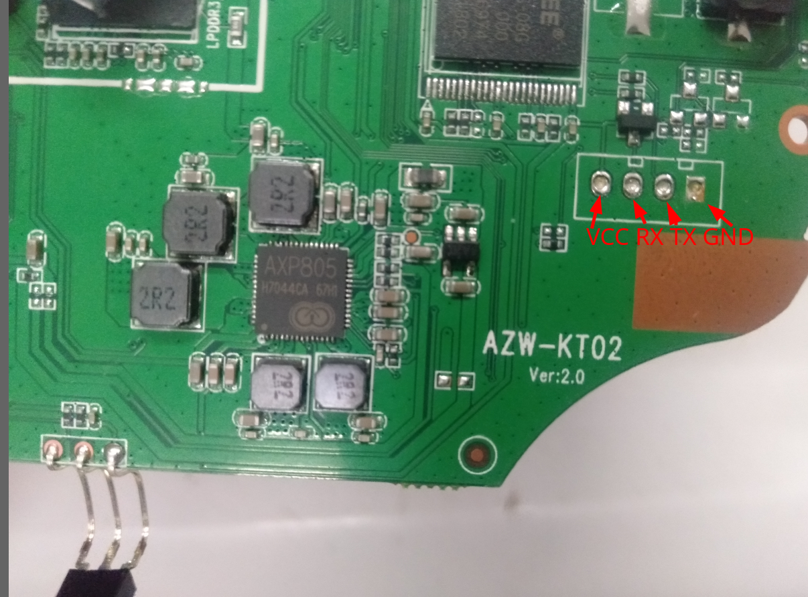

# 泰奇猫 TQC-A01

简体中文 | [English](./README.en_US.md)

[TQC 官网（已关闭）](http://web.archive.org/web/20190409212205/tq.ultrapower.com.cn/index.html)

## 硬件

| 规格 | 说明 |
| ----- | --- |
| PCB 版本  | AZW-KT02 2.0 |
| SoC   | 全志 [H6](https://linux-sunxi.org/H6)@1.8Ghz/V2000-AWIN/BGA451/15X15mm/四核 Cortex-A53 |
| 内存  | 1GiB LPDDR3 SpecTek [SS256M32V01MD1LPF-107BT](https://www.spectek.com/menus/we_detail.aspx?memType=LPDDR3)/PB047-125 PT/BGA178/1600Mbps |
| 供电 | DC 5V@2A |
| eMMC  | 8GiB eMMC 5.1 江波龙 Foresee eMMC [NCEMAM6G-08G](https://www.arrow.com/en/datasheets/9029653725/shenzhen-longsys-electronics-co.-ltd/ncemam6g-08g)/BGA153 |
| 无线模块 | 802.11b/g/n BT4.0 AMPAK [AP6212](https://fccid.io/PJ5-AX905/User-Manual/User-manual-3321089.pdf)/B11210011 1753/1T1R |
| PMU/PMIC | XPOWER [AXP805](http://linux-sunxi.org/images/b/bc/AXP805_Datasheet_V1.0_en.pdf)/H7044CA 67H1/3V to 5.5V/QFN56_7X7/|
| 网络变压器 | Apps [AE-SB16001](http://www.appselectronics.com/Uploads/product/5ae167b80285a.pdf) |
| 尺寸  | 96 * 96 * 17mm|

| 接口 | 说明  |
| ------------ | --- |
| USB 2.0 Host (Type-A) | * 1 |
| USB 3.0 Host (Type-A) | * 1 |
| USB 2.0 OTG (Micro USB) | * 1 |
| HDMI         | * 1 |
| 以太网     | 集成 10/100M PHY / RJ45 * 1 |
| WiFi         | 集成于 AP6212 BCM43430 * 1 |
| SPDIF        | * 1 |
| MicroSD      | * 1 |
| 红外     | * 1 |
| 蓝牙    | 集成于 AP6212 BCM43430A1 *1 |

## 全志 H6

[linux-sunxi H6](https://linux-sunxi.org/H6)

[linux-sunxi AC200](https://linux-sunxi.org/AC200)

| 规格 | 说明 |
| ------------- | ----------- |
| 制程 | 28nm |
| CPU | 四核 ARM Cortex-A53 @ 1.8GHz |
| GPU | Mali-T720 MP2 @ 600Mhz |
| 内存 | LPDDR2/LPDDR3/DDR3/DDR4 |

### FEL

[FEL](https://linux-sunxi.org/FEL)

> FEL 是全志设备 BootROM 中包含的底层子程序，用于通过 USB 对设备进行初始烧录和恢复。

请连接 USB 2.0 口，而不是 USB OTG 口 :)。

## AP6212

[AMPAK AP6212](https://deviwiki.com/wiki/AMPAK_AP6212)

| 功能 | 使用接口 |
| -------- | --------- |
| WiFi     |  SDIO     |
| 蓝牙       |  UART     |

## TTL 串口

## 主线 Linux

~~目前正在主线化过程中。~~

~~https://lore.kernel.org/linux-sunxi/20260226084850.417731-1-jerrysteve1101@gmail.com/T/~~

对应的设备树已包含在 Linux v7.1 中。

### 设备树

https://github.com/torvalds/linux/blob/master/arch/arm64/boot/dts/allwinner/sun50i-h6-taiqicat-a01.dts

### 外设状态

主线内核上各外设的实际（已测试）状态：

- ✅ 正常
- ❌ 无法工作
- 🟡 部分可用
- ⬜ 未测试

| 外设         | 状态 | 备注                                                        |
| ------------------ | ------ | ------------------------------------------------------------ |
| eMMC               | ✅      |                                                              |
| Wi-Fi (AP6212)     | ✅      |                                                              |
| 蓝牙 (AP6212) | ✅      |                                                              |
| 以太网           | ✅      | 已合入 v7.4。                                             |
| 显示 - HDMI     | ✅      |                                                              |
| USB 2.0 Host       | ✅      |                                                              |
| USB 3.0 Host       | ✅      |                                                              |
| USB 2.0 OTG        | ⬜      |                                                              |
| 音频 - HDMI       | ❌ | 需要额外补丁 [patches.megous/audio-7.3](https://github.com/armbian/build/tree/main/patch/kernel/archive/sunxi-7.3/patches.megous/audio-7.3) |
| 音频 - SPDIF      | ⬜      |                                                              |
| 存储 - MicroSD  | ✅      |                                                              |
| 红外           | ⬜      |                                                              |

## 固件

为 brcmfmac43430-sdio.ultrapower,taiqicat-a01.txt 添加符号链接配置：[WHENCE: add missing symlink for TaiqiCat (TQC) A01](https://gitlab.com/kernel-firmware/linux-firmware/-/merge_requests/1240/commits)

### WiFi

  > brcmfmac43430-sdio.bin
    brcmfmac43430-sdio.AP6212.txt

### 蓝牙 

  > BCM43430A1.hcd

## 主线 U-Boot

参见 [uboot-tqc-a01](https://github.com/Izumiko/uboot-tqc-a01)

### 视频硬件解码

> 主线 FFmpeg 目前缺少使用基于 v4l2-requests 的 API 所需补丁，但存在一个可用的分支[https://github.com/jernejsk/FFmpeg.git]。
>
> https://wiki.pine64.org/wiki/Mainline_Hardware_Decoding

Arch Linux ARM 用户可从 AUR 安装。

[ffmpeg-v4l2-request-git](https://aur.archlinux.org/packages/ffmpeg-v4l2-request-git)

## 论坛与博客

[泰奇猫TQC-A01强力推荐此盒子](https://www.znds.com/tv-1185657-1-1.html)

[TQC泰奇猫矿渣利用](https://www.right.com.cn/forum/thread-3469793-1-1.html)

> 泰奇猫这个是基于Allwinner H6 也就是全志H6 ARM64 芯片的一个盒子,整体这个机子的系统其实也是套用了公版sun50iw6 OrangePi3 实施的一个方案。

[网络设备杂谈 篇一：小猫变脑斧？？？！！！泰奇猫深度使用记录](https://post.m.smzdm.com/p/alxld6mp)

[网络设备杂谈 篇二：震惊! 矿渣wifi起死回生，背后的原因令人暖心。泰奇猫0成本wifi](https://post.m.smzdm.com/p/a4d4w5mx/)

[25元的泰奇猫盒子 还能刷Zidoo机顶盒系统](https://post.smzdm.com/p/awrnn9vg/)

[垃圾佬的日常 篇十四：25元就能体验到芝杜（zidoo）系统，一个纯净的电视盒子矿渣——泰奇猫](https://post.smzdm.com/p/anxxvrgp/)

[教你怎么刷芝杜/zidoo播放器系统-泰奇猫](https://www.hao4k.cn/thread-57639-1-1.html)

[矿渣 ：泰奇猫刷机芝杜（zidoo）系统](https://www.amobbs.com/thread-5750868-1-1.html)

[泰奇猫Zidoo h6 pro移植固件发布](https://www.znds.com/tv-1183570-1-1.html)

[泰奇猫Zidoo固件发布-更新完美线刷包20201115更新外置网卡版](https://bbs.nas66.com/thread-12104-1-1.html)

[矿渣论坛 - 硬件专区›泰奇猫](https://bbs.nas66.com/forum-42-1.html)

[矿渣篇：泰奇猫魔改](https://www.bilibili.com/read/mobile?id=9995897&ivk_sa=1024320u)

[TQC泰奇猫刷原版Android系统](https://post.m.smzdm.com/p/adwgz3ox/)

[40块买到原价1299的矿渣电视盒泰奇猫，能刷芝杜系统还能上4K](https://mbd.baidu.com/newspage/data/landingshare?pageType=1&nid=news_9259844976391711714&wfr=&_refluxos=)

[熊娃成全了他爹！40块包邮的泰奇猫电视盒子，还能刷芝杜系统](https://post.m.smzdm.com/p/ar66vp5z/)

[记录某全志H6矿渣LibreELEC系统适配过程](https://www.amobbs.com/thread-5751326-1-1.html)
