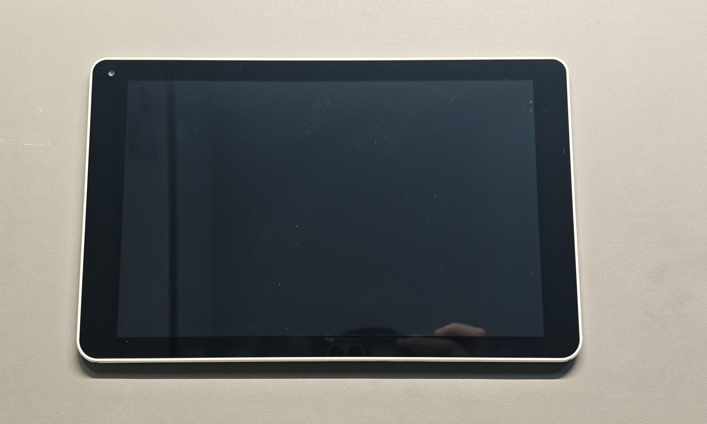

# Xereox ET1020

[English](README.md) · 简体中文

从QQ群友手上淘到的平板，原来是施乐打印机的控制面板 [1](https://github.com/retro98boy/rockchip-devices/tree/main/devices/xerox-et1020#%E7%A1%AC%E4%BB%B6)。 没有电池🔋，需要插电使用（Type-C)。

## 硬件

| 规格 | 描述 |
| --- | --- |
| 型号 | ET1020 |
| 序列号 | ET1020B180400580 |
| SoC | Rockchip RK3399 |
| PMIC | Rockchip RK818 |
| DRAM | 2GB DDR |
| eMMC | 16GB |
| WiFi/BT | AP6255？ |
| 显示屏 | 7.08/10.1? 英寸 1920x1200 60hz |
| 音频编解码 | ALC5645? |
| 前摄 | GC2145? / 2MP / 1600x1200 |
| 后摄 | OV8858? / 8MP / 3264 x 2448 / 自动对焦 |
| 加速度计 | MPU6500? |
| 角速度计 | MPU6500? |
| 霍尔传感器 | AK8963? |
| 磁力计 |  |
| 环境光传感器 | CM3218？ |

| 接口 | 描述 |
| --- | --- |
| 电源 | Type-C |
| 耳机口 | 3.5mm * 1 |
| Micro USB | * 1 |
| Micro SD | * 1 |
| 麦克风 | * 2? |
| 喇叭 | * 2 |
| 按键 | 电源键，返回键，音量加，音量减 |

## 图片

设备拆解细节见 [images](./images)。

## 调试串口

## Maskrom 模式

## Mainline Linux

### 设备树

感谢 [@retro98boy](https://github.com/retro98boy/rockchip-devices/tree/main/devices/xerox-et1020) 所做的工作，目前已适配了主线内核。

[rk3399-et1020.dts](https://github.com/yjun123/linux/blob/feature_xerox_et1020/arch/arm64/boot/dts/rockchip/rk3399-et1020.dts)

### 发行版

### 驱动

### 外设状态

## 参考

[Github - retro98boy/rockchip-devices - xerox-et1020](https://github.com/retro98boy/rockchip-devices/tree/main/devices/xerox-et1020)

[恩山无线论坛 - [RK3399]10.6英寸带触摸屏](https://www.right.com.cn/forum/thread-8337866-1-1.html)

[Bilibili - 当代玩物社 -【玩物】破解RK3399平板当作开发板-上](https://www.bilibili.com/video/BV1vf97B5E4c)

[Bilibili - 当代玩物社 -【玩物】破解RK3399平板当作开发板-下](https://www.bilibili.com/video/BV1EHdfBBERQ)
